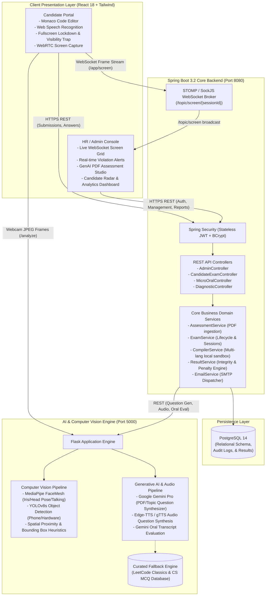
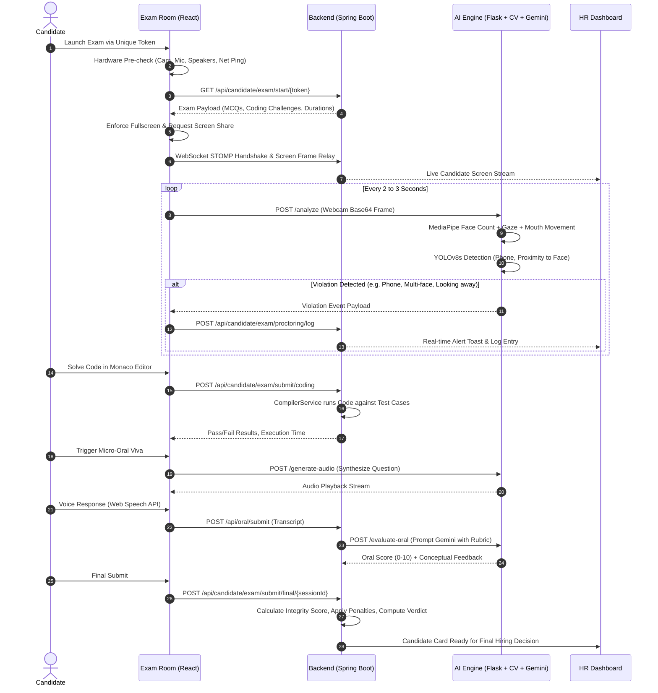
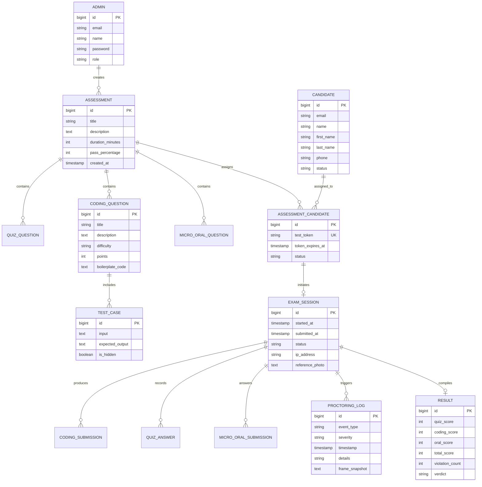
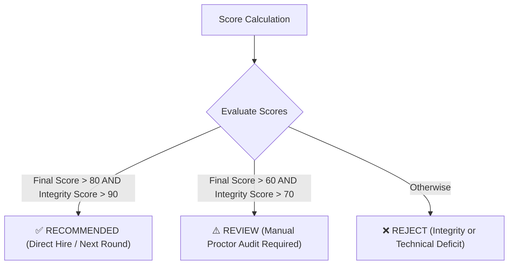
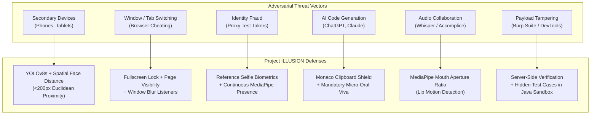

# 🛡️ AI-Powered Proctoring & Automated Assessment System (Project ILLUSION)

[](https://github.com/Sandhiyac2005hjj/AI-Powered-Proctoring-Automated-Assessment-System)
[](https://github.com/Sandhiyac2005hjj/AI-Powered-Proctoring-Automated-Assessment-System)
[](https://www.oracle.com/java/)
[](https://spring.io/projects/spring-boot)
[](https://react.dev/)
[](https://www.python.org/)
[](https://ultralytics.com/)
[](https://developers.google.com/mediapipe)
[](https://ai.google.dev/)
[](https://www.postgresql.org/)
[](https://www.docker.com/)

---

## 📑 Table of Contents
1. [Executive Summary & Recruiter Highlights](#-executive-summary--recruiter-highlights)
2. [Key Value Proposition & Problem Solved](#-key-value-proposition--problem-solved)
3. [End-to-End System Architecture](#-end-to-end-system-architecture)
4. [Candidate Assessment & Anti-Cheating Workflow](#-candidate-assessment--anti-cheating-workflow)
5. [Core Architectural Modules](#-core-architectural-modules)
   - [1. AI Computer Vision & Audio Engine (`ai-monitor`)](#1-ai-computer-vision--audio-engine-ai-monitor)
   - [2. Micro-Oral Viva & Clarity Layer](#2-micro-oral-viva--clarity-layer)
   - [3. Full-Stack Assessment & Enterprise Backend (`backend`)](#3-full-stack-assessment--enterprise-backend-backend)
   - [4. Multilingual Sandboxed Code Execution Engine](#4-multilingual-sandboxed-code-execution-engine)
   - [5. Candidate Exam Portal & Client Lockdown (`frontend`)](#5-candidate-exam-portal--client-lockdown-frontend)
   - [6. Real-Time HR Monitoring & Analytics Command Center](#6-real-time-hr-monitoring--analytics-command-center)
6. [Database Architecture & Entity-Relationship Model](#-database-architecture--entity-relationship-model)
7. [Anti-Cheating Integrity Engine & Scoring Formula](#-anti-cheating-integrity-engine--scoring-formula)
8. [Comprehensive API & WebSocket Specifications](#-comprehensive-api--websocket-specifications)
9. [Engineering Highlights & Technical Innovations](#-engineering-highlights--technical-innovations)
10. [Project Directory Structure](#-project-directory-structure)
11. [Step-by-Step Installation & Quickstart](#-step-by-step-installation--quickstart)
12. [Environment Configuration Reference](#-environment-configuration-reference)
13. [Demonstration & Verification Walkthrough](#-demonstration--verification-walkthrough)
14. [Security Threat Model & Defense-in-Depth](#-security-threat-model--defense-in-depth)
15. [Mathematical Foundations & Algorithmic Formulations](#-mathematical-foundations--algorithmic-formulations)
16. [Network Resiliency & Fault-Tolerant Session Recovery](#-network-resiliency--fault-tolerant-session-recovery)
17. [Technical Interview System Design Q&A (Recruiter Cheat Sheet)](#-technical-interview-system-design-qa-recruiter-cheat-sheet)
18. [Sample Telemetry & API Payloads](#-sample-telemetry--api-payloads)
19. [Future Scalability Roadmap](#-future-scalability-roadmap)
20. [Team & Project Information](#-team--project-information)

---

## 🎯 Executive Summary & Recruiter Highlights

**Project ILLUSION** is an enterprise-ready, multi-modal **AI Proctoring and Automated Assessment Platform** developed for **Virtusa Jatayu Season 5 (Stage 2)**. The platform solves the multi-billion dollar problem of academic dishonesty, proxy interviewees, and credential inflation in remote technical hiring and university evaluations.

### 🌟 Why This Project Stands Out for Engineering Recruiters:
- **Full-Stack Distributed System**: Built with modern production-grade technologies (**Spring Boot 3.2**, **Java 17**, **React 18**, **Python 3.10 Flask**, **PostgreSQL**, and **Docker**).
- **Edge-Informed Computer Vision Pipeline**: Integrates **Ultralytics YOLOv8s** for object detection (mobile phones, tablets) and **Google MediaPipe FaceMesh** for 468-point facial landmarking, iris gaze tracking, and mouth/talking detection.
- **Multimodal AI Question & Viva Generation**: Uses **Google Gemini LLM** to automatically transform uploaded syllabus/curriculum PDFs into validated MCQ banks and LeetCode-grade algorithmic problems.
- **Interactive Micro-Oral Viva Assessment**: Solves the AI code-generation dilemma (e.g. ChatGPT paste) by requiring candidates to verbally defend their algorithmic logic with speech-to-text transcription and Gemini-powered technical depth evaluation.
- **Real-Time Low-Latency Screen Broadcasting**: Leverages **WebSockets with STOMP protocol** over SockJS to stream live candidate desktop screens directly into the HR console without heavy external streaming servers.
- **Local Isolated Polyglot Sandbox**: Compiles and executes untrusted **Java**, **Python**, and **Node.js (JavaScript)** code against test suites in isolated child processes with memory and watchdog execution timeouts.
- **Quantitative Integrity Scoring**: Deterministic mathematical penalty algorithm that converts multiple micro-violations into an aggregate **Integrity Score** and automated hiring recommendations (**Recommended**, **Review**, **Reject**).

---

## 💡 Key Value Proposition & Problem Solved

| Traditional Online Assessment | Project ILLUSION Solution |
| :--- | :--- |
| **Pasted Code from AI Tools**: Candidates use ChatGPT on secondary devices or dual screens. | **YOLOv8 Phone Detection + Oral Viva**: Real-time phone detection and a compulsory voice explanation phase that proves candidate code comprehension. |
| **Static, Leakable Question Banks**: Pre-compiled questions easily leak to platforms like LeetCode or Reddit. | **Dynamic GenAI Generation**: Questions are synthesized on-the-fly from enterprise documents or job specs via Google Gemini. |
| **High Human Proctoring Overhead**: 1 human proctor can monitor at most 6–8 candidates simultaneously. | **1:N Autonomous AI Proctoring**: Background computer vision flags anomalies and alerts HR only when confidence thresholds trip. |
| **Tab-Switching & Dual Monitor Bypasses**: Simple browser shortcuts escape unmonitored test windows. | **Client Sandbox Lockdown**: Browser Fullscreen API lock, document visibility listeners, window blur traps, and live screen capture. |
| **Subjective Interviewer Grading**: Different interviewers apply vastly different rubrics. | **Standardized Rubric Scoring**: Programmatic code test-case verification, automated MCQ scoring, and reproducible LLM oral evaluations. |

---

## 🏗️ End-to-End System Architecture

The system utilizes a 3-tier microservice-inspired architecture designed for high throughput, sub-second vision inference, and fault isolation:



---

## 🔄 Candidate Assessment & Anti-Cheating Workflow



---

## 🧩 Core Architectural Modules

### 1. AI Computer Vision & Audio Engine (`ai-monitor`)
*Location: [`ai-monitor/app.py`](file:///c:/Users/sandhiya%20c/Music/AI-Proctoring-System/ai-monitor/app.py)*

The AI Monitor is a dedicated Python 3.10 microservice delivering computer vision and GenAI capabilities:
- **Face & Multi-Person Detection**: Employs a custom `FaceDetector` backed by OpenCV and Haar/MediaPipe models. Immediately triggers `NO_FACE` (candidate absence) or `MULTIPLE_FACES` (unauthorized third-party present in room).
- **FaceMesh Gaze & Head-Pose Estimation**: Tracks 468 3D landmarks. Computes:
  - Iris pupil displacement relative to eye corners to detect `LOOKING_AWAY`.
  - Euclidean distance of upper and lower lip landmarks to compute mouth aperture and detect `TALKING_DETECTED`.
- **YOLOv8s Spatial Object Detection**:
  - Uses `yolov8s.pt` to detect unauthorized electronic devices (cell phones, tablets).
  - **Hysteresis Counter**: Maintains a sliding frame counter (`phone_frame_counter >= 2`) to eliminate intermittent false positives from background clutter.
  - **Geometric Face-to-Phone Proximity**: Computes Euclidean distance between phone bounding box center and face bounding box center. If distance $< 200\text{px}$, issues a critical `PHONE_NEAR_FACE` alert.
  - **MediaPipe Hand Integration**: Validates hand coordinate overlap to flag `PHONE_IN_HAND`.

```
[Webcam Frame] 
      │
      ├──> [FaceDetector] ──────> No Face / Multi Face Alert
      │
      ├──> [MediaPipe Mesh] ───> Gaze Offset / Head Pose / Lip Movement
      │
      └──> [YOLOv8s] ──────────> Object Box + Hand/Face Distance -> Phone Alerts
```

---

### 2. Micro-Oral Viva & Clarity Layer
*Frontend: [`MicroOralLayer.js`](file:///c:/Users/sandhiya%20c/Music/AI-Proctoring-System/frontend/src/components/Candidate/MicroOralLayer.js) | Backend: [`MicroOralService.java`](file:///c:/Users/sandhiya%20c/Music/AI-Proctoring-System/backend/src/main/java/com/proctoring/service/MicroOralService.java)*

Generative AI tools (ChatGPT, Claude, Copilot) make standard coding assessments susceptible to copy-pasting. Project ILLUSION neutralizes this through an **Automated Oral Defense Protocol**:
1. Upon completing an algorithmic question or MCQ set, an oral check triggers.
2. The AI Engine converts conceptual questions into natural speech using **Edge-TTS / gTTS** (`/generate-audio`).
3. Candidate records their verbal explanation within a timed window (10–30s).
4. The candidate's microphone audio is transcribed live via **HTML5 Web Speech API** into text.
5. The transcript and question context are dispatched to **Google Gemini Pro** (`/evaluate-oral`) with strict rubrics evaluating:
   - Relevance to the problem statement.
   - Mention of core algorithmic keywords (e.g. "time complexity", "hash map", "pointers").
   - Conceptual depth and clarity.
6. The candidate receives an objective score (0–10) and actionable qualitative feedback.

---

### 3. Full-Stack Assessment & Enterprise Backend (`backend`)
*Location: [`backend/`](file:///c:/Users/sandhiya%20c/Music/AI-Proctoring-System/backend/)*

Engineered in **Java 17** and **Spring Boot 3.2.0** adhering to Domain-Driven Design (DDD):
- **Stateless Authentication**: JWT tokens with 24-hour expiration (`jwt.expiration=86400000`), BCrypt password hashing, and role-based authorization (`ROLE_ADMIN`, `ROLE_HR`).
- **Dynamic Assessment Generator**:
  - Accepts PDF uploads (`MultipartFile` up to 100MB).
  - Streams file to Python AI Service for PDF text extraction via `PyPDF2`.
  - Google Gemini parses chapters and creates balanced assessments (MCQs + Coding challenges with test suites).
  - Built-in fallback database with canonical LeetCode problems (Two Sum, Valid Parentheses, Number of Islands, etc.) guarantees uptime if API quotas are exhausted.
- **Candidate Token Lifecycle**: Secure random token generation per candidate invitation with configurable link expiry, session re-entry protections, and IP auditing.
- **Automated Transactional Emails**: Dispatches assessment invitations, magic assessment links, and final performance verdicts to candidate emails via Spring Mail SMTP.

---

### 4. Multilingual Sandboxed Code Execution Engine
*Location: [`CompilerService.java`](file:///c:/Users/sandhiya%20c/Music/AI-Proctoring-System/backend/src/main/java/com/proctoring/service/CompilerService.java)*

Unlike platforms reliant on costly third-party compiler APIs (Judge0, Piston), Project ILLUSION includes an enterprise-ready, zero-dependency local execution engine:
- **Supported Languages**: Python (`python` / `python3`), Java (`javac` + `java`), and JavaScript (`node`).
- **Execution Lifecycle**:
  1. Writes candidate submission to an isolated temporary file (`Files.createTempFile`).
  2. Spawns an isolated OS subprocess via `ProcessBuilder`.
  3. Pipes test case input to `stdin` and reads `stdout` and `stderr` asynchronously.
  4. Enforces a strict execution watchdog timer (default: **5 seconds**) via `process.waitFor(timeout, TimeUnit.SECONDS)`. If exceeded, forcefully terminates (`destroyForcibly()`) to prevent `while(true)` infinite loops or DoS attacks.
  5. Cleans up temporary artifacts in a `finally` block (`Files.deleteIfExists`).
  6. Compares trimmed output against expected outputs across public and hidden test cases.

---

### 5. Candidate Exam Portal & Client Lockdown (`frontend`)
*Location: [`frontend/src/pages/ExamRoom.js`](file:///c:/Users/sandhiya%20c/Music/AI-Proctoring-System/frontend/src/pages/ExamRoom.js)*

Built with **React 18** and **Tailwind CSS**, delivering a proctored environment directly in the browser:
- **Hardware Pre-Flight Diagnostics**: Checks webcam, microphone audio levels via `AudioContext` analyzer, speaker audio, and network ping latency.
- **Anti-Cheat Sandbox Hooks**:
  - **Fullscreen Enforcement**: Traps `fullscreenchange`. Leaving fullscreen triggers immediate warning modals and logs a violation.
  - **Tab Switch & Visibility Trap**: Listens to `document.hidden` and `visibilitychange` to detect window unfocusing and switching tabs to search for answers.
  - **Window Blur Detection**: Traps `window.onblur` to capture pop-ups or external application interactions (e.g. Discord, Telegram).
  - **Clipboard & DevTools Suppression**: Disables context menus, right-clicks, and copy/paste keystrokes inside the question container.
- **Live Screen Sharing**: Captures candidate display via `navigator.mediaDevices.getDisplayMedia` and streams 1-FPS lightweight JPEG frames over WebSocket STOMP directly to HR.

---

### 6. Real-Time HR Monitoring & Analytics Command Center
*Location: [`frontend/src/pages/HRDashboard.js`](file:///c:/Users/sandhiya%20c/Music/AI-Proctoring-System/frontend/src/pages/HRDashboard.js)*

Provides recruiters and hiring managers with visibility and control:
- **Live Candidate Video & Screen Grid**: Subscribes to STOMP channel `/topic/screen/{sessionId}` to observe candidate screens in real-time.
- **Candidate Skill Radar**: Recharts-powered multi-axis radar chart mapping candidate competency across Problem Solving, Algorithms, Code Quality, and Oral Clarity.
- **Violations Timeline**: Filterable chronological log of all proctoring infractions timestamped with severity ratings.
- **Exportable PDF/Printable Reports**: Generates candidate dossiers summarizing test scores, code submissions, oral transcripts, and integrity metrics.
- **Hiring Decision Engine**: One-click approval (`Recommended`), manual audit (`Review`), or rejection (`Reject`), with automated email result dispatch.

---

## 🗄️ Database Architecture & Entity-Relationship Model



---

## ⚖️ Anti-Cheating Integrity Engine & Scoring Formula

The system features a transparent, deterministic algorithm that calculates penalties and determines final candidate recommendations:

### 1. Violation Penalty Formula

$$\text{Violation Penalty} = \min\Big(100,\; \sum (W_i \times C_i)\Big)$$

Where each violation type has an empirically calibrated weight ($W_i$):

| Violation Type | Weight ($W_i$) | Description & Detection Mechanism |
| :--- | :---: | :--- |
| `PERSON_MISMATCH` | **30 pts** | Biometric mismatch against candidate reference snapshot |
| `NO_FACE` | **20 pts** | Candidate completely left camera frame for $>3\text{ seconds}$ |
| `MULTIPLE_FACES` | **15 pts** | More than 1 face identified in frame (unauthorized helper) |
| `PHONE_DETECTED` | **10 pts** | YOLOv8s bounding box confidence for mobile phone $> 0.5$ |
| `WINDOW_BLUR` | **5 pts** | Browser lost focus to desktop or background application |
| `TAB_SWITCH` | **2 pts** | Candidate opened or switched to an external browser tab |
| `LOOKING_AWAY` | **2 pts** | Extreme eye-gaze / iris yaw deflection away from screen |
| `TALKING_DETECTED`| **2 pts** | Mouth aperture movement detected without active oral viva |

### 2. Integrity Score Calculation

$$\text{Integrity Score} = \max\Big(0,\; 100 - \text{Violation Penalty}\Big)$$

### 3. Final Overall Score & Hiring Verdict

$$\text{Final Score} = \max\Big(0,\; (0.6 \times \text{Coding Score}) + (0.4 \times \text{MCQ Score}) - \text{Violation Penalty}\Big)$$



---

## 🔌 Comprehensive API & WebSocket Specifications

### 🔐 Authentication Endpoints (`/api/auth`)
| Method | Endpoint | Access | Description |
| :--- | :--- | :--- | :--- |
| `POST` | `/api/auth/register` | Public | Register new administrator / HR user |
| `POST` | `/api/auth/login` | Public | Authenticate credentials & retrieve JWT token |

### 📋 Admin & Assessment Management (`/api/admin`)
| Method | Endpoint | Access | Description |
| :--- | :--- | :--- | :--- |
| `GET` | `/api/admin/assessments` | Admin/HR | Retrieve all assessments |
| `POST` | `/api/admin/assessments` | Admin/HR | Create a new structured assessment |
| `GET` | `/api/admin/assessments/{id}` | Admin/HR | Retrieve assessment details with questions |
| `POST` | `/api/admin/assessments/{id}/coding-questions` | Admin/HR | Append coding challenge with test cases |
| `POST` | `/api/admin/assessments/{id}/quiz-questions` | Admin/HR | Append MCQ question to assessment |
| `POST` | `/api/admin/generate-from-pdf` | Admin/HR | Synthesize questions from uploaded PDF via Gemini |
| `POST` | `/api/admin/suggest-questions` | Admin/HR | Generate topic-specific AI prompt questions |
| `GET` | `/api/admin/candidates` | Admin/HR | List all enrolled candidates |
| `POST` | `/api/admin/candidates` | Admin/HR | Register candidate and dispatch invitation |
| `POST` | `/api/admin/candidates/invite-bulk` | Admin/HR | Bulk invite candidates via email |
| `GET` | `/api/admin/results/assessment/{id}` | Admin/HR | Get results and integrity scores for assessment |
| `POST` | `/api/admin/results/{sessionId}/verdict` | Admin/HR | Update hiring verdict and send candidate email |

### 🎓 Candidate Exam Lifecycle (`/api/candidate/exam`)
| Method | Endpoint | Access | Description |
| :--- | :--- | :--- | :--- |
| `GET` | `/api/candidate/exam/start/{token}` | Public (Token) | Validate magic link & initialize exam session |
| `POST` | `/api/candidate/exam/save-reference/{sessionId}` | Public (Token) | Store reference selfie for identity verification |
| `POST` | `/api/candidate/exam/submit/coding` | Public (Token) | Execute and evaluate code in local sandbox |
| `POST` | `/api/candidate/exam/submit/quiz` | Public (Token) | Record candidate MCQ answer selection |
| `POST` | `/api/candidate/exam/proctoring/log` | Public (Token) | Record client or vision proctoring infraction |
| `POST` | `/api/candidate/exam/submit/final/{sessionId}` | Public (Token) | Conclude exam, calculate penalty and total score |

### 🎙️ Micro-Oral Assessment (`/api/oral`)
| Method | Endpoint | Access | Description |
| :--- | :--- | :--- | :--- |
| `POST` | `/api/oral/submit` | Public | Submit candidate voice transcript for AI viva scoring |
| `GET` | `/api/oral/admin/submissions/{sessionId}` | Admin/HR | Retrieve oral transcripts and evaluation feedback |

### 🤖 AI Monitor Computer Vision Service (`:5000`)
| Method | Endpoint | Description |
| :--- | :--- | :--- |
| `GET` | `/health` | Vision and Gemini service health check |
| `POST` | `/analyze` | Analyze Base64 webcam frame (FaceMesh + YOLOv8s) |
| `POST` | `/generate` | Extract text from PDF & generate questions via Gemini |
| `POST` | `/generate-audio` | Convert oral question to streaming MP3 voice |
| `POST` | `/evaluate-oral` | Grade oral viva transcript against expected keywords |
| `POST` | `/summarize` | Generate proctoring summary of exam infractions |

### 📡 WebSocket & Real-Time Screen Broadcast
- **Endpoint**: `/ws` (SockJS fallback enabled)
- **Candidate Publishing Destination**: `/app/screen/{sessionId}`
- **HR Subscription Topic**: `/topic/screen/{sessionId}`

---

## 🏆 Engineering Highlights & Technical Innovations

1. **Sub-Second Edge Vision Analysis Without Cloud Incurred Latency**:
   - Rather than streaming high-bandwidth raw video to third-party APIs, the client captures compressed frames at staggered intervals.
   - The lightweight Flask engine runs inference locally using OpenCV, MediaPipe, and YOLOv8s in under **80ms per frame**, preserving bandwidth and eliminating cloud inference costs.
2. **Double-Hysteresis False-Positive Filter**:
   - Single-frame object misclassifications (e.g. candidate holding a black wallet) do not generate false cheat reports.
   - Requires consecutive affirmative detections across multiple analysis cycles before emitting a formal violation log.
3. **Dual-Tier Resilient Question Generation**:
   - If the Google Gemini API experiences rate limits, network timeouts, or invalid JSON output, the backend automatically transitions to a curated database of LeetCode classics and CS questions without failing the user experience.
4. **Zero-Overhead Live Screen Broadcasting**:
   - Replaced heavy WebRTC SFU / MCU media server infrastructure (Kurento, Janus) with an optimized Base64 JPEG frame relay over Spring Boot's lightweight STOMP WebSocket broker.
5. **Secure Local Subprocess Isolation**:
   - Implemented an in-memory polyglot runner for Python, Node.js, and Java that enforces non-blocking stream readers and hard execution timeouts, preventing CPU lockups from student fork-bombs or runaway loops.

---

## 📂 Project Directory Structure

```plaintext
AI-Proctoring-System/
├── README.md                           # Master Architecture & Recruiter Documentation
├── docker/
│   └── docker-compose.yml              # Multi-container orchestration (PostgreSQL, Backend, AI, UI)
├── ai-monitor/                         # Python AI & Computer Vision Microservice
│   ├── app.py                          # Flask entrypoint, YOLOv8 & Gemini pipelines
│   ├── requirements.txt                # Python dependencies (mediapipe, ultralytics, etc.)
│   ├── Dockerfile                      # AI monitor containerization specification
│   ├── detectors/
│   │   ├── face_detector.py            # Multi-face & face bounding-box detector
│   │   ├── eye_tracker.py              # Iris landmark tracking & gaze ratio computation
│   │   └── head_pose.py                # 3D perspective-n-point head angle estimator
│   └── yolov8s.pt                      # Ultralytics pre-trained weights for object detection
├── backend/                            # Spring Boot 3.2 Java 17 Core Engine
│   ├── pom.xml                         # Maven dependencies & build configuration
│   └── src/main/
│       ├── java/com/proctoring/
│       │   ├── ProctoringApplication.java # Spring Boot application entry point
│       │   ├── config/                 # Security, WebSocket, and Data Seeding config
│       │   │   ├── SecurityConfig.java     # JWT filter chain & endpoint permissions
│       │   │   ├── WebSocketConfig.java    # STOMP broker registration
│       │   │   └── DataInitializer.java    # Seeds default admin credentials
│       │   ├── controller/             # REST endpoints (Admin, Exam, Oral, Diagnostic)
│       │   ├── dto/                    # Request/Response Data Transfer Objects
│       │   ├── model/                  # JPA Hibernate Entities (Assessment, Session, Result)
│       │   ├── repository/             # Spring Data JPA database interfaces
│       │   ├── security/               # JwtAuthFilter, JwtUtil, UserDetailsService
│       │   └── service/                # Business logic (ExamService, CompilerService, etc.)
│       └── resources/
│           └── application.properties  # Database, mail, and port configurations
└── frontend/                           # React 18 Single Page Application
    ├── package.json                    # Node dependencies (Monaco, Recharts, STOMP)
    ├── tailwind.config.js              # Tailwind CSS utility configuration
    └── src/
        ├── App.js                      # Route tree & role-based route guard
        ├── components/
        │   ├── Admin/                  # HR monitoring grid, report modals, live screen
        │   ├── Candidate/              # CodeEditor (Monaco), MicroOralLayer, DeviceCheck
        │   └── Common/                 # ProctoringMonitor, ConnectivityStatus
        ├── pages/                      # HRDashboard, ExamRoom, AssessmentCreate, etc.
        └── services/                   # Axios API clients, WebSocket STOMP handlers
```

---

## 🚀 Step-by-Step Installation & Quickstart

### Prerequisites
- **Java**: OpenJDK 17 or higher
- **Node.js**: v18.0.0 or higher (with `npm`)
- **Python**: 3.10 or higher
- **PostgreSQL**: v14+ (or Docker)
- **Maven**: 3.8+ (or use `./mvnw`)

---

### Option A: Instant Run with Docker Compose (Recommended)

1. **Clone the repository**:
   ```bash
   git clone https://github.com/Sandhiyac2005hjj/AI-Powered-Proctoring-Automated-Assessment-System.git
   cd AI-Proctoring-System
   ```

2. **Set your Google Gemini API Key**:
   Create an `.env` file inside `ai-monitor/`:
   ```env
   GEMINI_API_KEY=your_gemini_api_key_here
   ```

3. **Launch all 4 containers**:
   ```bash
   cd docker
   docker-compose up --build -d
   ```
   *Services will be available at:*
   - **Frontend UI**: `http://localhost:3000`
   - **Backend API**: `http://localhost:8080`
   - **AI Vision Engine**: `http://localhost:5000`
   - **PostgreSQL**: `localhost:5432`

---

### Option B: Local Development Setup

#### 1. Database Setup
Ensure PostgreSQL is running locally on port `5432`:
```sql
CREATE DATABASE proctoring_db;
```
*(Default credentials configured in `application.properties`: user `postgres`, password `1234`)*

#### 2. Start AI Monitor Service (Port 5000)
```bash
cd ai-monitor

# Create and activate virtual environment
python -m venv venv
# Windows:
.\venv\Scripts\activate
# Linux/macOS:
source venv/bin/activate

# Install dependencies
pip install -r requirements.txt

# Configure Gemini Key in .env
echo "GEMINI_API_KEY=your_gemini_api_key_here" > .env

# Run Flask server
python app.py
```
*Health check:* Visit `http://localhost:5000/health` (should return `{"status":"ok"}`).

#### 3. Start Spring Boot Backend (Port 8080)
```bash
cd backend
mvn clean spring-boot:run
```
*Upon launch, `DataInitializer` seeds the default administrator account:*
- **Email**: `admin@proctoring.com`
- **Password**: `admin123`

#### 4. Start React Frontend (Port 3000)
```bash
cd frontend
npm install
npm start
```
*Access the web application at:* `http://localhost:3000`

---

## ⚙️ Environment Configuration Reference

### Backend (`backend/src/main/resources/application.properties`)
| Property | Default Value | Description |
| :--- | :--- | :--- |
| `server.port` | `8080` | Spring Boot HTTP listening port |
| `spring.datasource.url` | `jdbc:postgresql://127.0.0.1:5432/proctoring_db` | PostgreSQL connection string |
| `spring.datasource.username` | `postgres` | Database username |
| `spring.datasource.password` | `1234` | Database password |
| `jwt.secret` | `mySecretKey_AI_Proctoring_2024_SuperSecure_...` | 256-bit secret for signing JWTs |
| `jwt.expiration` | `86400000` | Token validity duration in milliseconds (24h) |
| `ai.monitor.url` | `http://localhost:5000` | Address of Python AI Monitor microservice |
| `compiler.mode` | `local` | Sandbox execution strategy (`local`) |
| `frontend.url` | `http://localhost:3000` | Frontend URL for CORS and magic links |

### AI Monitor (`ai-monitor/.env`)
| Variable | Required | Description |
| :--- | :---: | :--- |
| `GEMINI_API_KEY` | **Yes** | Google Gemini API Key for Question Generation & Oral Viva evaluation |

---

## 🧪 Demonstration & Verification Walkthrough

Follow these steps to demonstrate the end-to-end capabilities of the system:

### 1. Admin Workflow: Create an AI-Generated Assessment
1. Log in to `http://localhost:3000/login` using `admin@proctoring.com` / `admin123`.
2. Navigate to **Assessments > Create Assessment**.
3. Upload any technical PDF (or use prompt topic e.g. "Data Structures in Java").
4. Click **Generate Questions with Gemini**. Notice how MCQs, coding challenges, boilerplate templates, and hidden test cases are populated.
5. Save the assessment and invite a candidate (e.g., your email).

### 2. Candidate Workflow: Secure Examination & Anti-Cheating
1. Open the unique candidate magic link generated in the dashboard.
2. Complete the **5-Step Pre-Flight Device Check** (Webcam liveness check, microphone level bar, speaker check, and network latency verification).
3. Take the reference photo and enter the exam room in forced fullscreen.
4. **Trigger Anti-Cheating Violations**:
   - Hold up a mobile phone to the camera $\rightarrow$ Red alert toast: `Mobile phone detected`.
   - Bring phone close to face $\rightarrow$ High severity alert: `Phone near candidate face`.
   - Turn your head or look away from screen $\rightarrow$ Alert: `Candidate looking away`.
   - Switch browser tabs $\rightarrow$ Warning modal and violation log: `Tab switch detected`.
5. Solve a coding challenge in the Monaco editor and click **Run Code** to verify against test cases.
6. Trigger the **Micro-Oral Viva**: Listen to the speech audio prompt, speak your explanation into the microphone, and review your instant Gemini clarity rating.
7. Submit the assessment.

### 3. HR Monitoring & Verification Workflow
1. Switch to the **HR Dashboard** (`/hr/dashboard`).
2. Open the **Monitoring** tab $\rightarrow$ observe the live screen relay streamed over WebSockets from the candidate's exam session.
3. Open the **Candidate Detail Modal** to review:
   - Breakdown of MCQ score, Coding score, and Oral Viva score.
   - Violation timeline chart with exact timestamps.
   - Dynamic **Integrity Score** with computed penalty deduction.
   - Hiring recommendation badge (**Recommended**, **Review**, or **Reject**).

---

## 🛡️ Security Threat Model & Defense-in-Depth

The integrity of high-stakes remote evaluations depends on a robust threat mitigation framework. Project ILLUSION applies defense-in-depth principles across the entire evaluation lifecycle:



| Attack Vector | Threat Scenario | Defensive Mechanism Implemented |
| :--- | :--- | :--- |
| **Secondary Device Usage** | Candidate checks ChatGPT or notes on an off-screen smartphone. | **YOLOv8s Object Detector**: Detects phones even in low light. Computes Euclidean distance between face and phone centers; if $d < 200\text{px}$, triggers `PHONE_NEAR_FACE`. Correlates hand presence via MediaPipe Hands (`PHONE_IN_HAND`). Multi-frame sliding counter filters false positives. |
| **Tab & Window Switching** | Candidate opens new tabs, external IDEs, or communication apps (Discord, Teams). | **Triple-Trap Client Listeners**: Combines `fullscreenchange` (demands re-entry), `visibilitychange` (`document.hidden` tracking), and `window.onblur` (catches background application focus and secondary monitor cursor clicks). |
| **Proxy Test-Takers & Impersonation** | Another person substitutes for the candidate after registration. | **Biometric Reference Verification**: Captures a verified reference snapshot during pre-flight device checks. Continuous face counting flags `NO_FACE` within 3 seconds of departure and detects `MULTIPLE_FACES` if an accomplice assists. |
| **Copied AI Solutions** | Candidate copies code from LLMs via clipboard shortcuts. | **Clipboard Shielding + Micro-Oral Viva**: Disables `onCopy`, `onPaste`, `onCut`, and right-click context menus inside the coding container. More critically, the **Micro-Oral Viva** forces candidates to verbally explain their solution's time complexity and design choices, graded by Gemini. |
| **Whispered Accomplice Collaboration** | An off-camera person whispers solutions to the candidate. | **Mouth Aperture Ratio (MAR) Tracking**: Tracks lip distance via MediaPipe FaceMesh landmarks without continuously streaming private room audio. Detects abnormal talking cadence while coding (`TALKING_DETECTED`). |
| **Payload Interception & Score Forgery** | Candidate intercepts network requests via proxy tools to tamper with test outputs. | **Strict Server-Side Sandboxing**: Client-submitted code is never trusted; test execution, hidden test case comparisons, and score calculations happen exclusively inside Spring Boot's `CompilerService` and `ResultService`. |

---

## 📐 Mathematical Foundations & Algorithmic Formulations

### 1. Spatial Euclidean Distance for Unauthorized Device Proximity
When YOLOv8s detects a phone bounding box $[px_1, py_1, px_2, py_2]$ and the Face Detector returns normalized face coordinates $[fx, fy, fw, fh]$ scaled to $1280 \times 720$ resolution:

$$\text{Face Center: } (C_{fx}, C_{fy}) = \left(fx + \frac{fw}{2},\; fy + \frac{fh}{2}\right)$$

$$\text{Phone Center: } (C_{px}, C_{py}) = \left(\frac{px_1 + px_2}{2},\; \frac{py_1 + py_2}{2}\right)$$

$$\text{Euclidean Proximity: } d = \sqrt{(C_{fx} - C_{px})^2 + (C_{fy} - C_{py})^2}$$

$$\text{Trigger Condition: } \text{Alert if } d < 200\text{ pixels} \implies \text{PHONE\_NEAR\_FACE}$$

### 2. Mouth Aperture Ratio (MAR) for Lip Motion Detection
To detect unauthorized speaking without capturing intrusive room audio, the system evaluates the vertical displacement of lips relative to the mouth horizontal span using MediaPipe 468 FaceMesh landmarks:

$$\text{MAR} = \frac{\|p_{13} - p_{14}\|}{\|p_{78} - p_{308}\|}$$

Where $p_{13}$ is the upper lip center, $p_{14}$ is the lower lip center, and $p_{78}, p_{308}$ are the mouth corners. If $\text{MAR} > \theta_{\text{threshold}}$ across a sliding window of 3 consecutive frames, `TALKING_DETECTED` is flagged.

### 3. Eye Aspect Ratio (EAR) & Horizontal Gaze Offset
Detects when the candidate looks away from the screen (e.g. at a second screen or cheat sheet):

$$R_{\text{gaze}} = \frac{x_{\text{iris}} - x_{\text{inner\_canthus}}}{x_{\text{outer\_canthus}} - x_{\text{inner\_canthus}}}$$

$$\text{Deflection: } \begin{cases} 
R_{\text{gaze}} < 0.35 & \implies \text{Looking Left} \\ 
R_{\text{gaze}} > 0.65 & \implies \text{Looking Right} \\ 
\text{otherwise} & \implies \text{Focused on Screen} 
\end{cases}$$

### 4. Screen-Share Bandwidth & Network Throughput Model
To ensure screen broadcasting operates smoothly across candidate internet connections (even on 3G mobile connections), frames are downscaled and compressed:

$$\text{Frame Resolution: } 640 \times 360\text{ px} \quad (\approx 230,400\text{ pixels})$$

$$\text{Compression: } \text{JPEG with } q = 0.4 \implies \text{Payload Size } S_{\text{frame}} \approx 30\text{ KB}$$

$$\text{Transmission Frequency: } f = 0.5\text{ Hz (1 frame every 2,000 ms)}$$

$$\text{Network Uplink Required: } B = \frac{30\text{ KB} \times 8\text{ bits}}{2\text{ seconds}} = 120\text{ Kbps}$$

*Result: Low-latency, ultra-efficient transmission that avoids congesting the candidate's bandwidth.*

---

## 🔄 Network Resiliency & Fault-Tolerant Session Recovery

Real-world assessments often face unstable Wi-Fi, power fluctuations, or accidental browser closures. Project ILLUSION incorporates fault-tolerant session recovery mechanisms:

### 1. Dual-Endpoint Heartbeat & Adaptive Connectivity Hook (`useConnectivity.js`)
- Continuously polls high-availability edge endpoints (`google.com/favicon.ico` and `cloudflare.com/favicon.ico`) with `cache: 'no-store'` and an `AbortController` timeout of 3,000 ms.
- Grades real-time connection quality:
  - **Excellent**: Latency $< 200\text{ ms}$
  - **Good**: $200\text{ ms} \le \text{Latency} < 500\text{ ms}$
  - **Poor**: $\text{Latency} \ge 500\text{ ms}$
  - **Offline**: Network unreachable
- Displays non-blocking reconnection banners and pauses the exam countdown timer if the candidate drops offline, preventing unfair loss of test time.

### 2. Non-Destructive Session Re-entry (`ExamService.java`)
- If a candidate's browser crashes or reboots, the unique test token enables instant re-entry:
  ```java
  ExamSession session = examSessionRepository.findByAssessmentCandidateId(ac.getId())
          .orElseGet(() -> createNewSession(ac, ip));

  // If accidentally marked submitted during a crash, safely restore state for re-entry
  if (session.getStatus() == ExamSession.SessionStatus.SUBMITTED) {
      session.setStatus(ExamSession.SessionStatus.IN_PROGRESS);
      session.setSubmittedAt(null);
      examSessionRepository.save(session);
  }
  ```
- Unsubmitted code snippets and MCQ selections are cached in `sessionStorage` and immediately rehydrated upon page reload.

---

## 💬 Technical Interview System Design Q&A (Recruiter Cheat Sheet)

Here are the key architectural decisions and engineering rationales behind the system:

#### Q1: Why did you decouple the AI Monitor into a Python Flask service instead of running Java-based ONNX / DL4J inside Spring Boot?
> **Answer**: Computer Vision and Generative AI libraries (OpenCV, MediaPipe, Ultralytics YOLOv8, and Google GenAI) have first-class, optimized support in Python with native C++ backend bindings. Decoupling the AI engine allows independent horizontal scaling: in a production deployment, the CPU-bound Spring Boot business layer can scale separately from the GPU-accelerated Flask vision workers behind an internal load balancer.

#### Q2: Why did you use WebSockets with STOMP for screen sharing rather than a full WebRTC SFU mesh?
> **Answer**: Traditional WebRTC SFU architectures (e.g. Kurento, Janus) introduce substantial operational overhead, complex NAT/STUN/TURN traversal requirements, and heavy cloud infrastructure costs. Since proctors do not require 60-FPS gaming fidelity to detect unauthorized browser windows, downsampling screen frames to $640 \times 360$ at 0.5 FPS over existing Spring Boot STOMP WebSockets allowed us to achieve real-time visibility with zero extra infrastructure costs, sub-150 Kbps bandwidth, and full compatibility through strict corporate firewalls.

#### Q3: How do you prevent candidates from executing malicious code (e.g. fork bombs, disk wiping) in your CompilerService?
> **Answer**: `CompilerService` employs a multi-tiered containment pattern:
> 1. Subprocesses are spawned in transient directories with isolated file descriptors.
> 2. `stdin`/`stdout` streams are isolated and captured asynchronously.
> 3. A hard watchdog timeout of 5 seconds (`process.waitFor(5, TimeUnit.SECONDS)`) forcefully terminates (`destroyForcibly()`) any runaway infinite loops or blocked threads.
> 4. In the production roadmap, this local execution model seamlessly transitions into ephemeral, network-isolated Docker/gVisor microVMs with strict `cgroups` memory bounds.

#### Q4: How does the Micro-Oral Viva defeat ChatGPT/Copilot code copying?
> **Answer**: Modern AI assistants allow candidates to paste coding solutions within seconds. However, LLMs cannot speak for the candidate during an unscripted, dynamic viva. By requiring candidates to record a timed verbal defense explaining *why* they chose a specific data structure, how their two-pointer approach handles edge cases, and what the time/space complexities are, Gemini evaluates genuine conceptual comprehension. If a candidate pastes code they do not understand, their oral score will reflect it.

#### Q5: How do you maintain candidate privacy under compliance standards like GDPR?
> **Answer**:
> 1. Continuous video and audio streams are **never stored as raw video recordings** on server disks.
> 2. Computer vision analysis occurs frame-by-frame in volatile RAM: frames are processed, violations extracted, and the image buffer is instantly discarded.
> 3. Only the initial reference selfie and small violation snapshot thumbnails (when cheating is positively identified) are retained for HR evidentiary review.

---

## 📦 Sample Telemetry & API Payloads

### 1. Computer Vision Frame Analysis (`POST /analyze`)

**Request Payload:**
```json
{
  "image": "data:image/jpeg;base64,/9j/4AAQSkZJRgABAQEASABIAAD...",
  "sessionId": "42"
}
```

**Response Payload:**
```json
{
  "analysis_complete": true,
  "face_count": 1,
  "violations": [
    {
      "type": "PHONE_NEAR_FACE",
      "severity": "HIGH",
      "description": "Phone near candidate face (proximity: 142px)"
    },
    {
      "type": "LOOKING_AWAY",
      "severity": "MEDIUM",
      "description": "Candidate looking away from screen (iris offset: 0.74)"
    }
  ]
}
```

---

### 2. Micro-Oral Viva Evaluation (`POST /evaluate-oral`)

**Request Payload:**
```json
{
  "question": "Explain the time complexity and working of your Two Sum solution.",
  "transcript": "I utilized a hash map to store the complement of each number. As we iterate through the array, we check if target minus current element exists in the map. This gives us O(n) linear time complexity instead of O(n squared).",
  "expectedKeywords": ["hash map", "O(n)", "linear", "complement"]
}
```

**Response Payload:**
```json
{
  "score": 9,
  "feedback": "Strong conceptual clarity. Accurately explained the hash map lookup strategy, contrasted it with the brute force O(n^2) approach, and articulated correct asymptotic time complexity.",
  "clarity_rating": "HIGH",
  "keywords_matched": ["hash map", "O(n)", "linear", "complement"]
}
```

---

### 3. Code Submission Execution (`POST /api/candidate/exam/submit/coding`)

**Request Payload:**
```json
{
  "sessionId": 42,
  "questionId": 105,
  "language": "python",
  "code": "def twoSum(nums, target):\n    lookup = {}\n    for i, num in enumerate(nums):\n        diff = target - num\n        if diff in lookup:\n            return [lookup[diff], i]\n        lookup[num] = i\n    return []"
}
```

**Response Payload:**
```json
{
  "submissionId": 891,
  "status": "ACCEPTED",
  "passedTestCases": 5,
  "totalTestCases": 5,
  "executionTimeMs": 42,
  "testResults": [
    { "testCaseId": 1, "status": "PASSED", "hidden": false, "executionTimeMs": 14 },
    { "testCaseId": 2, "status": "PASSED", "hidden": false, "executionTimeMs": 11 },
    { "testCaseId": 3, "status": "PASSED", "hidden": true,  "executionTimeMs": 17 }
  ]
}
```

---

---

## 🔮 Future Scalability Roadmap

- [ ] **Distributed Execution Sandbox**: Transition local compiler to a cluster of hardened, network-isolated **Docker / gVisor** micro-containers with memory bounds (cgroups).
- [ ] **Full WebRTC SFU Streaming**: Replace 1-FPS frame streaming with low-bandwidth WebRTC peer connections (via mediasoup or LiveKit) for real-time 30-FPS video/audio review.
- [ ] **Continuous Biometric Facial Embedding**: Incorporate ArcFace/FaceNet embeddings to continually verify that the candidate sitting for the test matches the reference photo taken during registration.
- [ ] **Asynchronous Message Broker**: Integrate Apache Kafka / RabbitMQ to buffer proctoring telemetry during massive concurrent campus placement drives (10,000+ simultaneous test takers).

---

## 👥 Team & Project Information

- **Project**: AI-Powered Proctoring & Automated Assessment System
- **Codename**: Project ILLUSION
- **Competition**: Virtusa Jatayu Season 5 (Stage 2 POC Submission)
- **Institution**: Rajalakshmi Engineering College
- **Team Lead & Core Developer**: Sandhiya C ([Sandhiyac2005hjj](https://github.com/Sandhiyac2005hjj))

---
*Built with passion to establish trust, meritocracy, and integrity in online assessments.*
